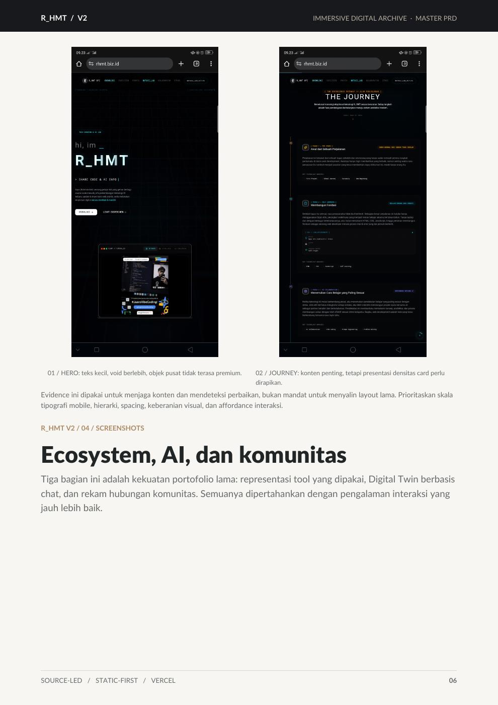
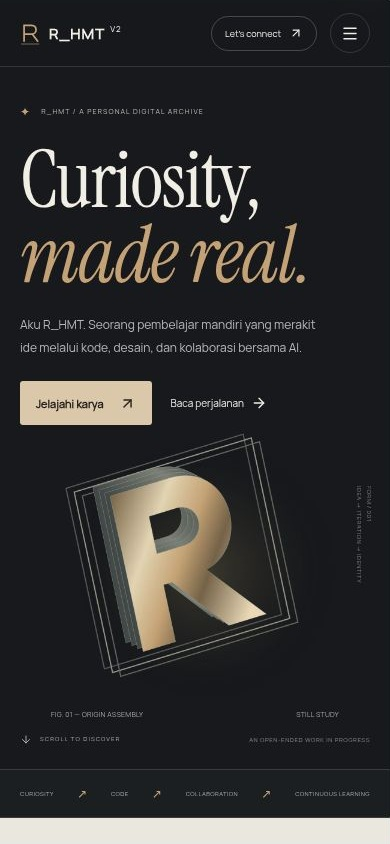
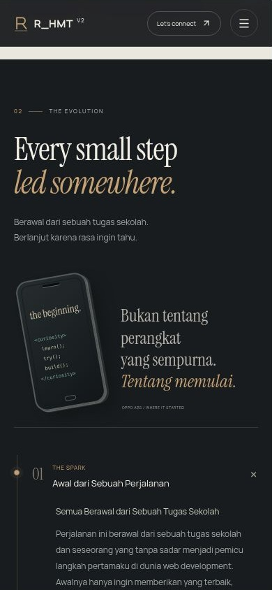
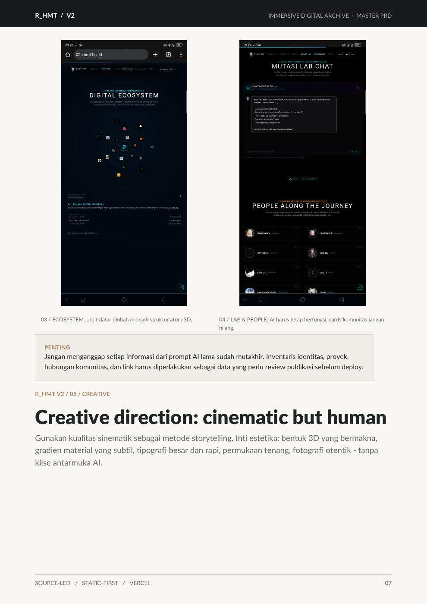
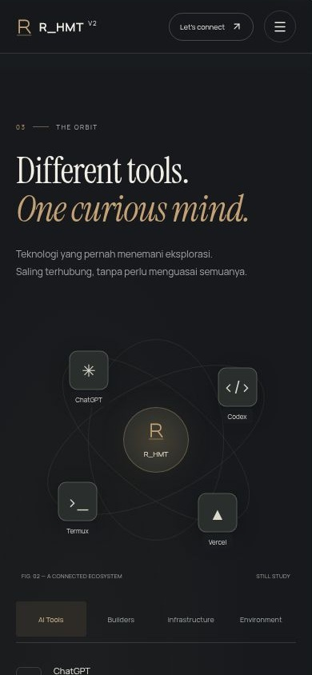
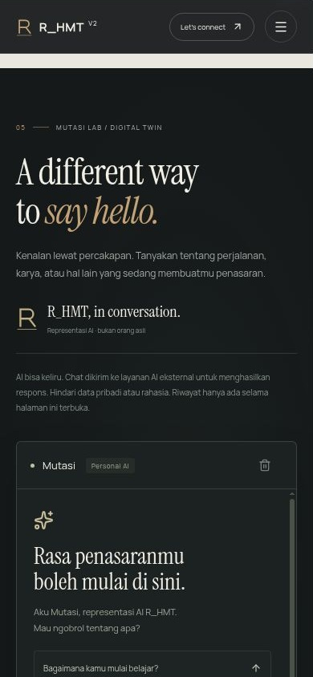
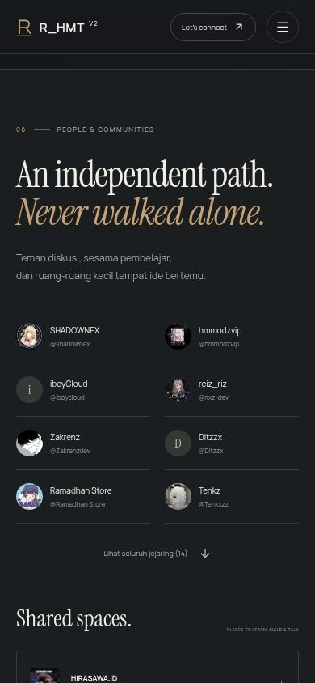

## Revisi V2.1

Preview terbaru ada di `screenshots/v2.1/`: foto pp asli menggantikan monogram hero; pp-dev kembali menjadi ikon identitas; Space Grotesk/Manrope menggantikan serif. Lapisan foto, progress scroll, rail perjalanan, arsip asimetris dan galeri berperspektif memperkuat arah PRD. Referensi di bawah merekam V2.0.

# Perbandingan sebelum dan sesudah

**Sebelum** berasal dari screenshot pengguna yang tercantum dalam Master PRD, halaman 6–7. Ini bukan rerender source lama dan ukuran perangkat aslinya tidak diketahui. **Sesudah** adalah screenshot browser nyata dari implementasi V2 pada iframe 390×844. Artwork hero yang terlihat adalah fallback, karena WebGL pada browser QA tidak tersedia.

## Hero dan perjalanan

Sebelum: 

Sesudah hero: 

Sesudah journey: 

## Tools, percakapan, dan jejaring

Sebelum: 

Sesudah tools: 

Sesudah lab: 

Sesudah jejaring: 

Perubahan utama: typography editorial lebih besar, kontras charcoal/ivory, affordance tombol/focus yang jelas, daftar teks tools tetap tersedia, dan status link/error AI yang jujur. Screenshot lengkap desktop, tablet, dan mobile ada di folder `screenshots`.
